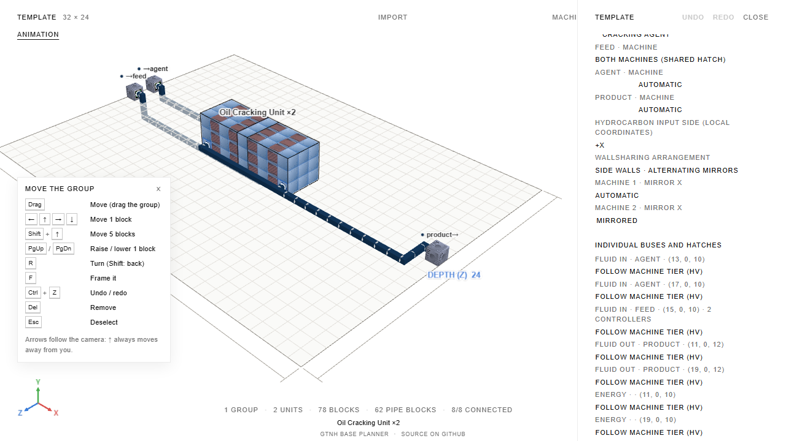

# Этап 3: зеркало юнита и выбор wallsharing

Реализован после отдельного подтверждения пользователя. Дополнение пользователя: выбранный
вариант wallsharing считается предпочтением; допустима автоматическая замена. Предыдущие
принятые этапы 6–7 сохранены и запушены коммитом
`b0e6188c1fa58c19d330bb38943d209b5f8d176b`.

## Поведение

В инспекторе выбранной группы добавлен выбор Automatic, Side walls,
Stack, Back walls, Separate machines. Если предпочтение несовместимо с ресурсами или
жёсткими пределами, алгоритм перебирает остальные существующие семейства расположений.
Инспектор показывает пояснение о замене. Пределы `limitsLocked` сохраняются.

Для Oil Cracking Unit и Mega Oil Cracker доступен индивидуальный выбор mirror X:
Automatic, Normal, Mirrored. Зеркало отражает локальную ось X перед поворотом юнита;
одинаково преобразуются клетки, стороны, контроллер, ограничения лиц и направления.
Автоматические кандидаты включают обе фазы чередования соседей. Ручные зеркала имеют
приоритет во всех кандидатах. Существующая допустимая автоматическая раскладка остаётся
исходным кандидатом; зеркальные альтернативы проверяются при нехватке люков.

Общий боковой люк разрешён только при совпадении допустимых типов у всех владельцев:
вход-вход или выход-выход. Без совместимой ориентации смешанная вход-выход стена остаётся
запрещённой. Общий агент доступен по вертикали и в заднем среднем столбце.
Общий люк расходует ёмкость каждой содержащей его структуры; энергия и обслуживание
остаются отдельными. Один люк обслуживает одну жидкость.

`wallsharing` и `unitMirrors` сохраняются в файлах, ссылках, localStorage, при дублировании,
Arrange, Optimize, Neat и undo/redo. Отсутствующие поля старых планов означают авто;
отсутствующий флаг зеркала конкретного юнита означает обычную ориентацию.
Настройка несуществующей машины сохраняется для возврата числа машин, но при размещении
игнорируется с предупреждением. Кеши учитывают зеркала и предпочтения.

## Проверка по игре

Проверен закреплённый исходник `MTEOilCracker`: `addLeftHatchToMachineList` и
`addRightHatchToMachineList` назначают сторону входа/выхода во время проверки структуры,
а не запрещают общий боковой люк. Минимум корпусов остаётся 18.

Выполнен ровно один разрешённый native-сценарий: пара обычных крекеров из текущей
раскладки планировщика в одном игровом мире. Оба реальных `checkMachine` прошли,
у каждого **20 корпусов**, один и тот же физический входной люк найден в обоих
списках `mInputHatches`. Результат: **1 passed, 0 failed**, стенд завершился успешно.

Сохранены [результат](../tools/game-dump/cracker-wallsharing.result.json),
тестовая фабрика и экспортёр единственного случая. Тест связывает результат с SHA256
текущих клеток и с закреплёнными SHA256 реально загруженных GT5U/StructureLib JAR.
Клетки: `5e3735982d09c0c955a020ec64bfea2984f73d940a89ae124005b607dec2a3de`.
Локальные пути JAR и логов в сохранённый результат не включены.

## Регрессии и производительность

Проверяются все четыре поворота, обе фазы зеркала, несовместимая общая стена,
перерасход ёмкости обоих владельцев даже при ошибочном списке `unitIds`, общий выход,
общий агент, ручные зеркала, мягкие предпочтения, жёсткий предел одного слоя,
обратная совместимость кодеков и неизменность назначений/тиров после команд.
E2E проверяет worker и резервный путь, историю, перезагрузку и Neat.
Детерминированный список property-теста и его seeds не расширены.

Первый полный прогон обнаружил два превышения прежнего лимита 20 секунд на
нефтепереработке (Arrange и Neat). Профиль показал лишние повторные поиски размещения:
равномерное отражение чистой стопки/заднего ряда не добавляет новых совместимых боковых
клеток. Такие дубликаты исключены; ручные зеркала сохраняются. Оба проблемных файла
затем прошли (35 тестов). Таймауты и бюджеты поиска/размера не повышены.

Итоговые проверки:

| Проверка                                           | Результат                                                                        |
| -------------------------------------------------- | -------------------------------------------------------------------------------- |
| `npm run format:check`                             | Все файлы отформатированы                                                        |
| `npm run check`                                    | 0 ошибок, 0 предупреждений                                                       |
| `npm test`                                         | 4819 тестов, 91 файл; 239,66 с                                                   |
| Дополнительный тест автоматического выбора зеркала | Добавлен после полного прогона; вместе проходят все 21 тест wallsharing (1,95 с) |
| `npm run test:invariant`                           | 89 тестов; 25,47 с                                                               |
| `npm run e2e`                                      | 62 теста; 2,3 минуты                                                             |
| `npm run build`                                    | Production-сборка успешна                                                        |
| `npm run size`                                     | Main 378,3/400 КБ; worker 139,0/140 КБ; остальные бюджеты соблюдены              |
| `npm run catalog:status`                           | Перегенерированные таблица и данные совпадают с сохранёнными                     |
| `git diff --check`                                 | Чисто                                                                            |

Прежние отслеживаемые снимки, перезаписанные E2E, восстановлены. Для этапа сохранены
два отдельных снимка; снимок настроек снят после завершения сборки при перезагрузке
и просмотрен. После усиления ожидания сцены оба целевых E2E-теста снова прошли (12,3 с).

## Границы и остановка

Зеркало для других машин не открыто, новый аудит и новые адаптеры не выполнялись.
Игровая проверка покрывает только указанную пару обычных крекеров; Mega покрыт
геометрическими тестами, без нового native-сценария. Поиск остаётся ограниченным
числом существующих кандидатов и не обещает глобального оптимума.
Каталог изменён только пояснением в `notes` обычного крекера; ограничения разных типов
стен не ослаблены. Известные ограничения уточнены в `known-limitations.md`.

Этап 3 принят пользователем 09.10.2026. Разрешены отдельный коммит и пуш его результатов
в ветку `codex/fix-update` форка. После сохранения — итоговый отчёт и остановка;
новые этапы и расширение объёма не начинаются.
