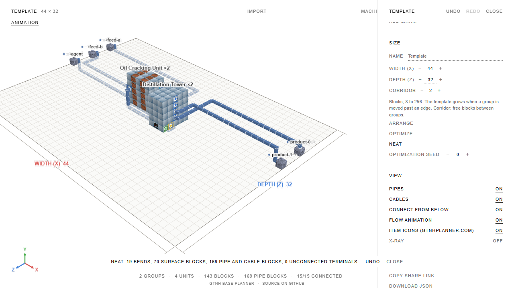

# Этап 5, шаг 5: кнопка «Аккуратно»

Реализовано по подтверждению пользователя от 09.10.2026. Сверено с `PLAN.md`, строки 152–160.
Перед реализацией сохранены принятые доработки предыдущих шагов:
`d524ba888c8d95300b2de1bbab06fb1dcbcc88d4`, ветка `codex/fix-update`, пуш в форк подтверждён
совпадением удалённого хэша. В тот коммит явно добавлены 77 файлов; логов, архивов,
`.tool-cache`, профилей CPU и файлов больше 50 МБ нет. Старый неподтверждённый вариант из
`outputs` не включён.

## Поведение

- В панели шаблона рядом с Arrange и Optimize добавлена кнопка `Neat` («Аккуратно»).
- Одна команда: канонические ряды вдоль потока и общие коридоры, аккуратная трассировка,
  независимые проверки, сводка фактических поворотов, поверхностных блоков, общей длины труб
  и кабелей, неподключённых терминалов. Optimize не вызывается.
- У старых планов без `routing` режим меняется на Neat только после успешной команды;
  простое чтение файла по-прежнему означает Compact. Глубина по умолчанию 3;
  уже выбранная глубина 1–6 сохраняется. Сохраняется согласованная политика стоимости:
  предпочтение −1, затем более глубоких слоёв; короткие поверхностные подводы допустимы,
  если обход дороже.
- Сохраняются размер шаблона, пределы всех групп (включая незаблокированные), число машин,
  роли, `unitId`/`unitIds`, выходные слоты, тиры, связи и порты. Группы можно переносить на этажи,
  но перепаковывать с другими пределами эта команда не будет.
- Исходный план трассируется в исходном режиме. Предложенный план проверяется после
  трассировки; новая структурная ошибка или увеличение числа неподключённых отклоняют его.
  Если не помещается без изменения пределов, режим и раскладка остаются исходными.
- Изменение режима и координат — один шаг undo/redo. Повтор идентичного результата
  не публикует клон документа и не добавляет шаг истории. Результат редактируемого или
  заменённого задания не применяется.
- Worker и резервный runtime используют одну функцию. Резервный код продолжает загружаться
  через `import()`, устаревшие задания отбрасываются и во время загрузки.

## Проверки

Новые model-тесты проверяют пять принятых эталонов, исходный режим, идемпотентность,
сводку из реальной сборки и отсутствие новых нарушений. На эталоне с двумя крекерами
проверяются разные `unitId` сырья, общий агент `unitIds: [0, 1]` и физический люк сырья EV.
Отдельно проверяются отказ при ухудшении структуры или подключённости именно от смены
режима и отказ от перепаковки незаблокированной группы, которая не помещается.

Тесты команд проверяют единственный шаг истории, точную сводку, повтор без записи,
undo/redo и игнорирование отклонённого, отменённого или устаревшего результата.
Тесты контроллера проверяют Neat через worker → реальный fallback при сбое и отмену
устаревшего задания во время загрузки резервного runtime.

Два E2E-сценария проходят с worker и с заблокированным worker: старая схема без `routing`,
ручные назначения и общий агент, сводка и подключённость, повтор, один undo, redo,
перезагрузка localStorage и сохранение выбранной глубины 5.

Первый общий тест нефтепереработки превысил 20 секунд на нескольких полных трассировках.
Он разделён на исходную сборку, команду и повтор с общим кешем уже рассчитанных документов;
все утверждения сохранены, таймауты не повышены. В E2E исправлено ожидание существующей
отложенной записи localStorage перед её чтением.

Итоговые проверки:

| Проверка                 | Результат                                                           |
| ------------------------ | ------------------------------------------------------------------- |
| `npm run format:check`   | Все файлы отформатированы                                           |
| `npm run check`          | 0 ошибок, 0 предупреждений                                          |
| `npm test`               | 4781 тест, 88 файлов; 251,18 с                                      |
| `npm run test:invariant` | 89 тестов; 23,77 с                                                  |
| `npm run e2e`            | 58 тестов; 2,1 минуты                                               |
| `npm run build`          | Production-сборка успешна                                           |
| `npm run size`           | Main 375,6/400 КБ; worker 138,3/140 КБ; остальные бюджеты соблюдены |
| `git diff --check`       | Чисто                                                               |

После E2E восстановлены его изменения прежних отслеживаемых снимков. Для новой кнопки
сохранён отдельный проверенный снимок. Шаг 5 принят пользователем 09.10.2026;
разрешены его коммит и пуш. Коммит `d524ba8` содержит ранее принятые доработки,
сохранённые до этого шага; шаг 5 сохраняется отдельным коммитом вместе с данным отчётом.

## Ограничения и остановка

Neat делает ровную сетку и не обещает уменьшения каждой метрики маршрута; для улучшения
стоимости остаётся Optimize. При уже существующих ошибках команда допускает только
сохранение или уменьшение нарушений и не скрывает их. Увеличение тестовых таймаутов,
бюджетов размера, зеркало юнита, аудит, новые адаптеры и native-сценарии не выполнялись.

Снимок интерфейса:

После отчёта остановка. Этапы 6–7 и зеркало отдельно не разрешены.
