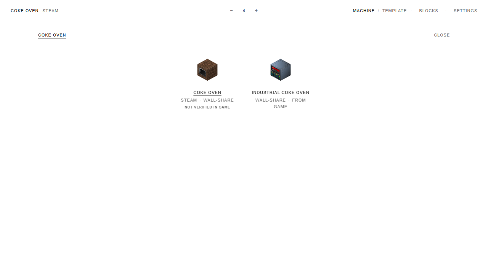
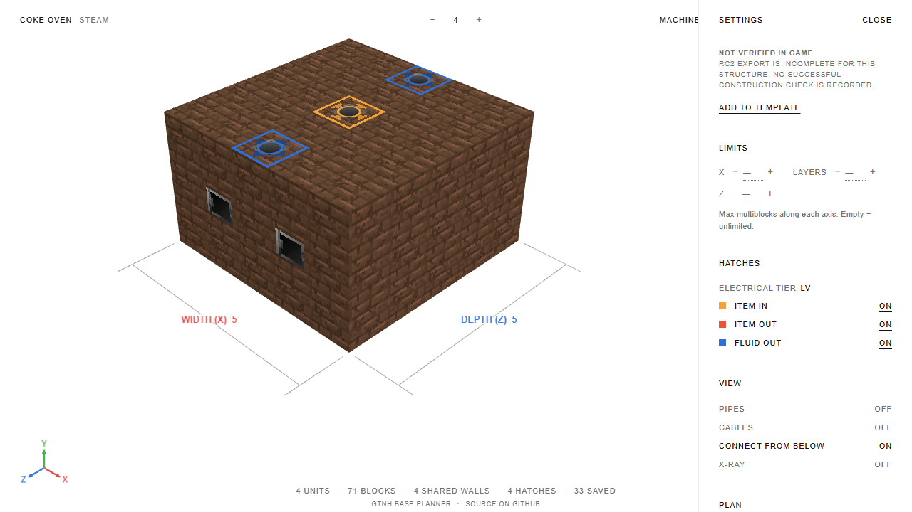
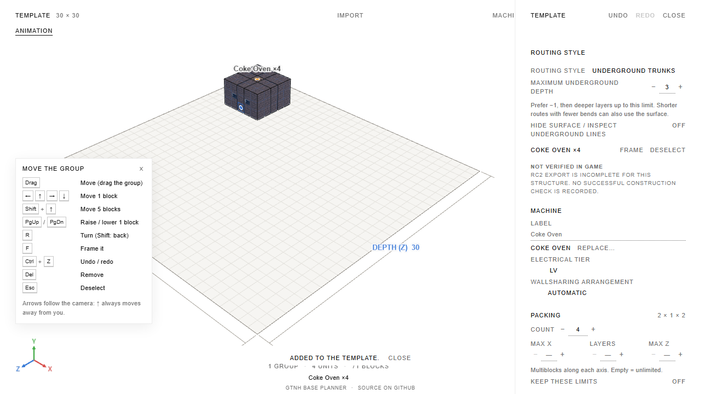

# Этап 6: ограниченный список проблемных записей

Уточнение от 2026-10-10: [решение пользователя](decisions-2026-10-10.md) разделяет отметки.
Текущие таблица и реестр содержат 37 нейтральных «Не проверено в игре», 18 «Известная проблема»
для отказов формы/исключений и прежнюю «Ограниченная поддержка» Boldarnator. Ниже сохранён
исторический отчёт исходного этапа 6.

Этап выполнен в пределах списка из `tools/game-dump/catalog-results.rc2.json`.
[Таблица статусов](plan-v3-stage-6-status.md) содержит 56 уникальных машин: 15 отказов формы
по умолчанию, 4 исключения стенда и 37 записей без экспорта. Boldarnator и четыре формы,
сохранённые из старого конвертера, уже находятся в этом списке.

## Решения

Все 56 записей получили статус ограниченной поддержки с причиной. Из выбора ничего не скрыто.
Новых адаптеров нет: из сохранённых эталонов в список попадает только Pyrolyse Oven
(`reference-03-medium.json`). Его запись сообщает о несопоставленных физических блоках экспортёра;
она не устанавливает дефект размещения в планировщике. Регрессии обычных групп, property-инвариант
и эталонные планы проверяются существующими тестами, без расширения списка машин.

| Причина в интерфейсе                                                          | Количество |
| ----------------------------------------------------------------------------- | ---------: |
| Экспорт RC2 неполон; успешной игровой проверки нет                            |         33 |
| Сохранённая проверка отвергла форму по умолчанию                              |         14 |
| Сохранённая проверка закончилась исключением                                  |          4 |
| Старая форма; интеграционные моды отсутствовали в дампе                       |          4 |
| Зоны жидкости Boldarnator не согласованы с RC2; работа отложена пользователем |          1 |

Данные частичные и исторические. Ни адаптер, ни отсутствие экспорта не объявляются доказательством
игровой корректности. Статус не превращается в новое предупреждение о структуре пользовательского
плана. Старые ID, формы, параметры и сохранённые планы остаются доступными.

## Изменения

- `scripts/catalog-status.mjs` одним запуском генерирует Markdown-таблицу и компактный реестр
  причин `src/data/catalog-support.generated.json`. Читает существующие игровые результаты,
  исходные формы, реестры количеств/корпусов и уже имеющиеся декораторы каталога. Проверяет
  уникальность, суммы статусов и совпадение версии игры. Не запускает геометрию, маршрутизацию или игру.
- `npm run catalog:status -- --check` проверяет актуальность обоих артефактов; добавлена проверка в CI.
- `CatalogSupport.svelte` показывает отметку и причину в выборе машин, настройках и редакторе группы.
  Конкретная причина заменяет общее сообщение `From game` в редакторе для ограниченного списка.
  Реестр импортируется только интерфейсом и не добавляется в worker.
- Обновлён `known-limitations.md`. Добавлены 9 unit-тестов и 2 E2E-теста: полнота списка,
  разные причины, неверные реестры, отсутствие ложных отметок для других ID, отображение причины,
  выбор старой формы и сохранение после перезагрузки. Таймауты и бюджеты не менялись.

## Проверка

| Проверка                            | Результат                        |
| ----------------------------------- | -------------------------------- |
| Форматирование и `git diff --check` | Пройдены                         |
| `npm run check`                     | 0 ошибок, 0 предупреждений       |
| `npm run catalog:status -- --check` | Оба артефакта актуальны          |
| `npm test`                          | 4790 тестов, 90 файлов; 238,78 с |
| `npm run test:invariant`            | 89 тестов; 24,42 с               |
| `npm run e2e`                       | 60 тестов; 2,2 мин               |
| `npm run build`                     | Production-сборка пройдена       |
| `npm run size`                      | Все бюджеты пройдены             |

Основной файл: **376,9 / 400 КБ gzip**, ниже принятой цели 385 КБ (до этапа: 375,6 КБ).
Worker: **138,3 / 140 КБ**, CSS: **5,0 / 6 КБ**, атлас: **156,1 / 170 КБ**,
весь сайт: **4475,0 / 4864 КБ**. Бюджеты не повышались.

В первом запуске генератора обнаружена вариативность уже существующего реестра количеств:
правило содержит либо `kind`, либо `anyOf`. Генератор учитывает оба случая. Для его импорта
в TypeScript-тестах добавлена декларация `catalog-status.d.mts`. Правила размещения не менялись.
Перезаписанные полным E2E-прогоном прежние скриншоты восстановлены; три новых снимка этапа 6
сохранены отдельно. Существующий неотслеживаемый каталог `outputs/` не входит в доработку.

## Скриншоты

Новые native-сценарии, probe-скрипты, поиск рецептов, аудит остальных машин и работа над Boldarnator
не выполнялись. Этап 7 и зеркало юнита не начаты. После отчёта — остановка до подтверждения.
